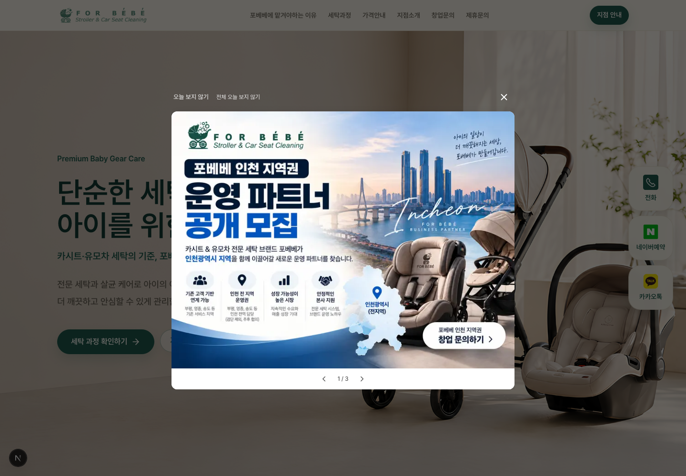
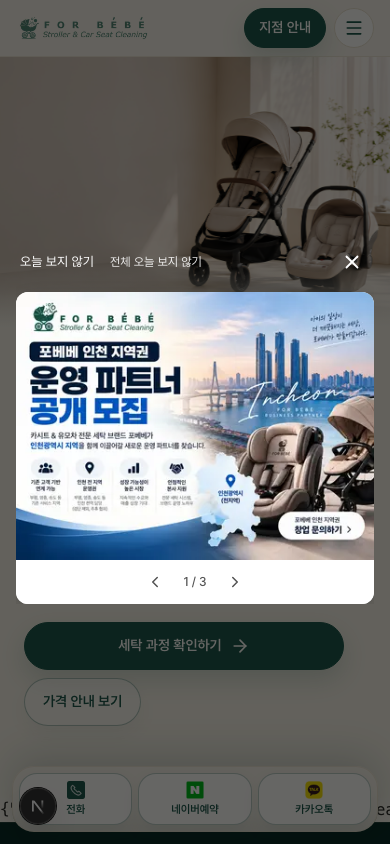

# 팝업 축소·상세 링크 제거·바깥 클릭 닫기

- 데스크톱 기준을 `50vw`, 최대 `720px`로 축소했습니다. 이전 기준은 `60vw`, 최대 `960px`이었습니다. 모바일 좌우 기본 16px 여백과 화면 높이에 맞춘 조절은 유지합니다.
- 상세내용확인 영역을 제거했습니다. 1개이면 이미지 아래에 빈 하단 영역이 없고, 2개 이상이면 탐색 줄만 표시합니다. 여러 개에서 1개로 줄어도 불필요한 하단 공간을 제거합니다.
- Sanity의 버튼 문구 입력과 신규 항목의 기본 버튼 문구를 제거했습니다. 이미 저장된 `buttonLabel`은 숨김·읽기 전용 필드로 보존하며 프런트엔드 쿼리·슬라이드 데이터에서는 제외합니다. 실제 CMS 데이터를 삭제하거나 덮어쓰지 않았습니다.
- 이미지 연결 URL은 유지하며 CMS에서 **이미지 연결 URL**로 관리합니다. 이미지 클릭의 내부 현재 탭·외부 새 탭 및 `noopener noreferrer`, 스와이프·스크롤 후 오클릭 차단은 그대로입니다.
- 팝업 바깥을 클릭·터치하면 X와 같은 함수로 현재 표시 대상 전체를 현재 탭의 세션 동안 숨깁니다. 포커스와 배경 스크롤을 복원합니다. 팝업 내부에서 시작해 바깥에서 끝난 드래그·스와이프는 닫기로 처리하지 않습니다.
- 기존 다중 팝업 순서·활성화·ID·노출 버전과 오늘 숨김 정책은 유지했습니다. 운영 배포·CMS 게시는 하지 않았습니다.

## 화면

| PC · 다중 · 너비 720px | 모바일 390px · 다중 |
| --- | --- |
|  |  |

## 검증

실제 로컬 Chromium 렌더링이며 모바일은 터치 에뮬레이션입니다. 검증용 임시 화면은 제거했습니다.

| 항목 | 결과 |
| --- | --- |
| Sanity 버튼 문구 입력 제거·새 항목 기본값 제거·이미지 URL 유지 | 통과 |
| 최대 720px·50vw 및 모바일 좌우 16px, 상세 링크 제거 | 통과 |
| 단일 팝업은 이미지 아래 빈 영역 없음, 다중에서 1개가 되어도 하단 제거 | 통과 |
| 다중 탐색과 개별·전체 오늘 숨김, 일반 닫기·포커스 복원 유지 | 통과 |
| 이미지 내부 현재 탭·외부 새 탭과 보안 속성 유지 | 통과 |
| 모바일 스와이프 후 이미지 오클릭 차단·키보드 포커스 유지 | 통과 |
| 팝업 바깥 PC 클릭·모바일 터치는 X와 동일한 전체 세션 숨김, 새로고침 유지 | 통과 |
| 팝업 안에서 시작해 밖에서 끝난 드래그·스와이프는 닫기나 이미지 링크로 오인하지 않음 | 통과 |

[브라우저 검증 JSON](./verification.json)

회귀 검사 13개, 최종 린트·TypeScript·프로덕션 빌드를 통과했습니다. 임시 검증 경로가 빌드에 포함되지 않는 것도 확인했습니다.

## 변경 파일

- `src/components/ui/ImagePopup.tsx`: 크기 축소, 상세 영역 제거, 단일 하단 공백 제거, 바깥 클릭·터치 닫기.
- `src/sanity/schemaTypes/homePopup.ts`: 버튼 문구 입력·기본값 제거, 기존 값 숨김 보존, 이미지 URL 안내.
- `src/lib/homePopup.ts`, `src/lib/sanity/queries.ts`, `src/types/index.ts`: 표시 데이터·조회에서 버튼 문구 제거, 기존 데이터 보존.
- `tests/homePopup.test.mjs`: 제거된 문구가 표시 데이터에 포함되지 않고 이전 값은 보존되는지 검증.
- `README.md`, `docs/home-popup.md`, 이 보고서: 최신 동작·관리·검증 안내.
