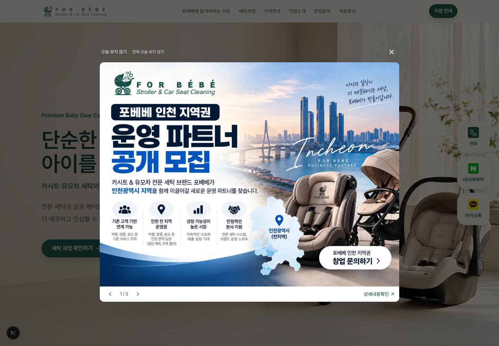
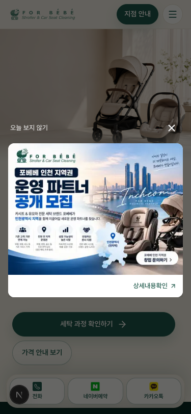
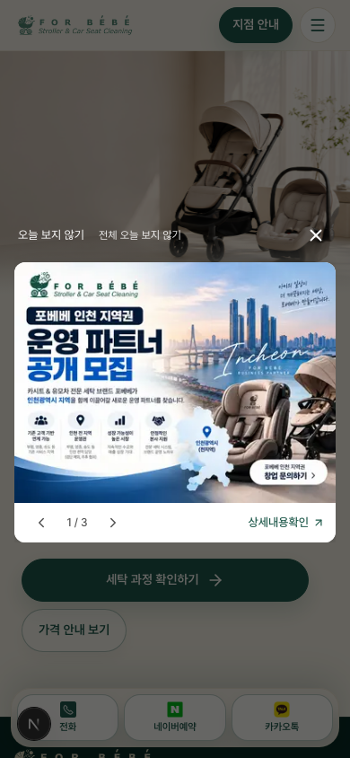
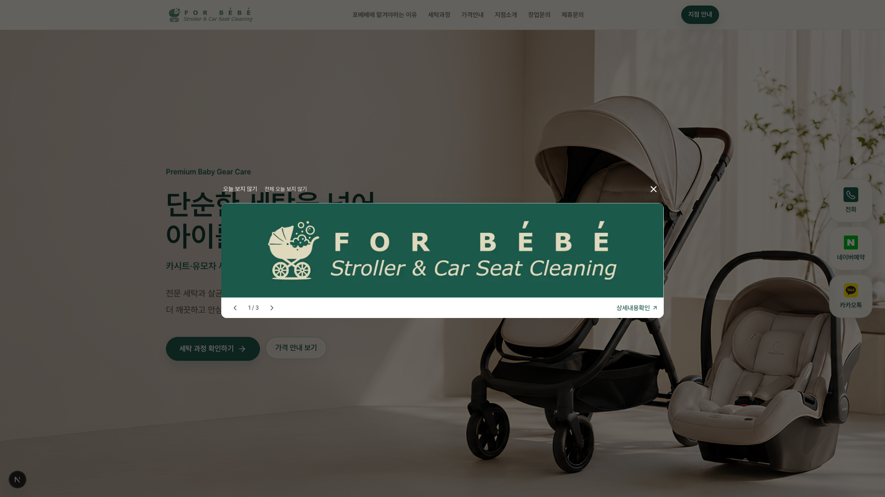
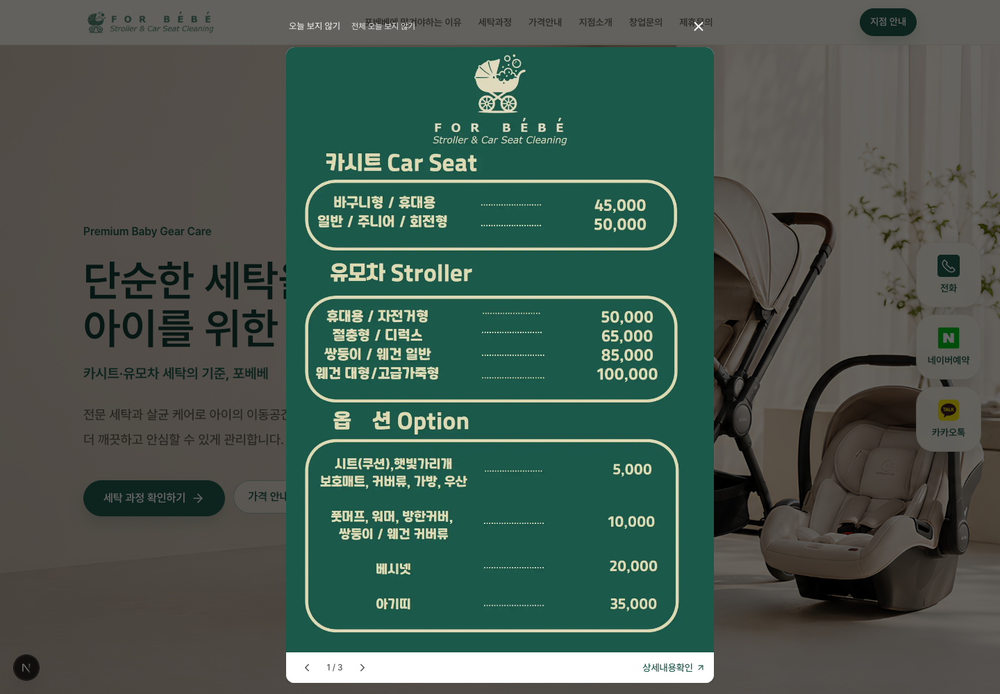
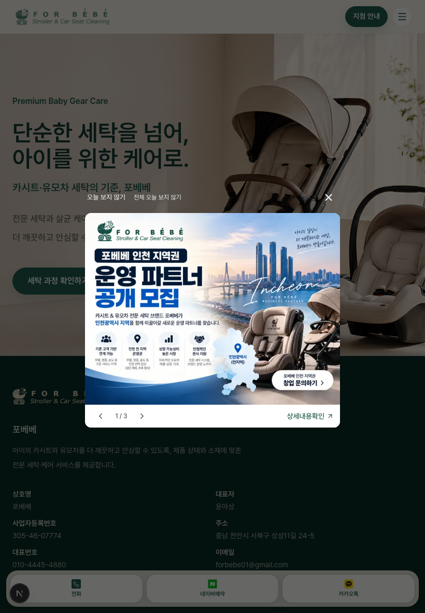
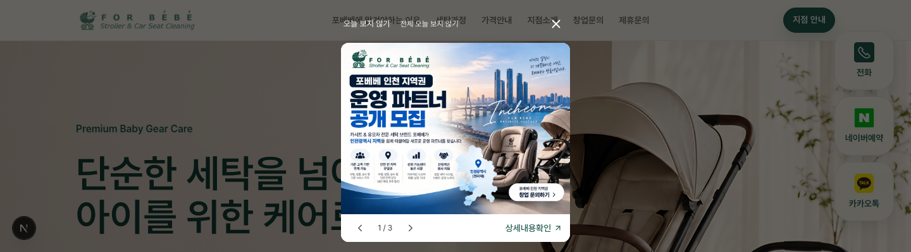
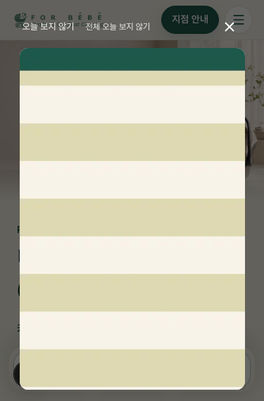
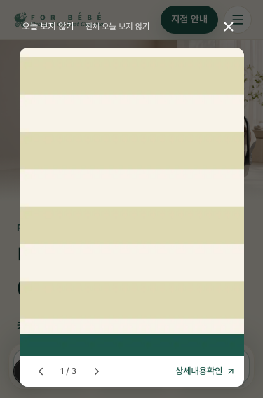
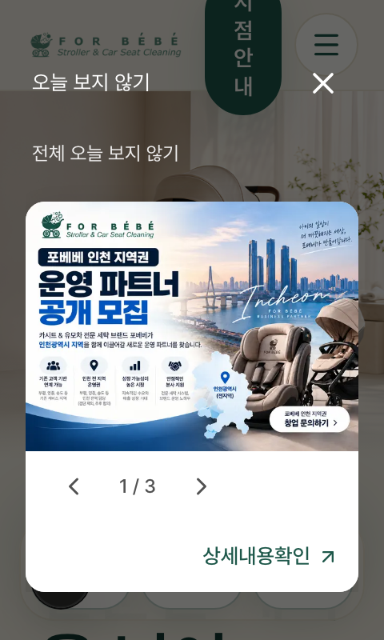

# 유동형 팝업·이미지 링크 개편

기존 Sanity 문서와 데이터, 다중 팝업 순서, ID·노출 버전, 일반/오늘 숨김 정책을 유지했습니다. 이번 변경은 프런트엔드 레이아웃·링크·포인터 처리와 문서에 한정합니다. 운영 배포와 CMS 게시는 하지 않았습니다.

## 구현

- **크기:** 768px 이상 화면의 선호 너비는 `min(60vw, 960px)`, 모바일은 `100vw - 32px`입니다. 사용 가능한 높이에서 상단 조작부·8px 간격·하단 줄의 높이를 빼고 이미지 비율을 곱해 너비를 함께 조절합니다.
- **측정:** 실제 조작부·하단 줄 높이를 ResizeObserver로 측정합니다. 문구가 줄 바뀌어도 크기 계산에 반영됩니다. 모달을 열고 측정하는 작업은 첫 표시 전 layout effect에서 처리합니다.
- **예외 화면:** 읽을 수 있는 너비를 확보하기 위해 최소 너비는 화면 범위 내 최대 320px입니다. 이미지가 매우 길어 더 줄이면 읽기 어려운 경우 카드 내부에서 스크롤합니다. 조작부가 커지는 극단적인 저높이·확대 환경에서는 모달 바깥 컨테이너도 내부 스크롤을 지원합니다. 가려진 내용을 삭제·크롭하는 방식은 사용하지 않습니다.
- **상단:** 카드 밖, 같은 dialog 안의 투명한 조작 줄입니다. 흰색 '오늘 보지 않기'·보조 '전체 오늘 보지 않기', 오른쪽 22px X를 배치합니다. X는 44×44px이며 사각 배경·원형 테두리가 없습니다. 조작 줄과 카드 사이 간격은 8px입니다. 카드 스크롤과 조작 줄이 분리되어 이미지를 덮지 않습니다.
- **카드:** 원본 비율의 이미지와 바로 아래의 44px 흰색 줄, 12px 모서리, 약한 그림자로 구성합니다. 이미지 높이를 고정하거나 여백을 채우는 flex-grow는 없습니다.
- **하단:** 2개 이상일 때 왼쪽에 이전·현재 위치·다음을, 오른쪽에는 13–14px의 CMS 문구와 ↗ 아이콘을 표시합니다. 큰 녹색 버튼은 제거했습니다. 좁거나 긴 문구가 있는 화면에서는 줄바꿈하고 내부 스크롤로 접근합니다.
- **링크:** 이미지와 상세 텍스트 모두 Next Link가 렌더링하는 실제 anchor이며 동일한 링크 속성을 공유합니다. 내부는 현재 탭, 외부는 `_blank`와 `noopener noreferrer`입니다. 목적을 알 수 있는 이미지 링크 접근성 이름과 외부 새 탭 안내를 제공합니다.
- **터치:** 포인터가 10px 넘게 움직이거나 실제 스크롤·pointercancel이 발생하면 이미지의 후속 포인터 클릭을 막습니다. 가로 50px 이상·세로보다 우세한 스와이프는 슬라이드를 바꾸고 링크를 열지 않습니다. 새 정상 탭은 다시 허용합니다. 키보드 Enter, 수정 키 클릭, 중간 버튼 동작도 유지합니다. 터치 시작을 preventDefault하지 않으므로 세로 스크롤·핀치 동작을 유지합니다.
- **접근성:** 정적인 외곽선 장식을 없애고 `focus-visible`에서만 명확한 실선 포커스를 표시합니다. Tab·Shift+Tab 순환, Escape, 포커스/스크롤 복원, 배경 비활성화·스크롤 잠금을 유지합니다.

## 실제 렌더링 측정

일반 이미지는 현재 CMS에 등록된 1448×1086 안내 이미지이며, 가로형·세로형 검증은 기존 프로젝트 이미지를 사용했습니다. 극단적 비율 검증용 중립 이미지는 로컬 검증 후 제거했습니다. 실제 CMS에 테스트 이미지·링크를 저장하지 않았습니다.

| 조건 | 화면 | 팝업 너비 × 높이 | 내부 스크롤 |
| --- | --- | --- | --- |
| 데스크톱 · 1개 | 1440×1000 | 864.00×744.00px | 없음 |
| 데스크톱 · 3개 | 1440×1000 | 864.00×744.00px | 없음 |
| 넓은 화면 · 가로형 | 1920×1080 | 960.00×301.33px | 없음 |
| 데스크톱 · 세로형 | 1440×1000 | 615.95×968.00px | 없음 |
| 태블릿 · 3개 | 820×1180 | 492.00×465.00px | 없음 |
| 모바일 · 1개 | 375×812 | 343.00×353.25px | 없음 |
| 모바일 · 3개 | 390×844 | 358.00×364.50px | 없음 |
| 높이가 낮은 화면 | 1440×400 | 362.66×367.98px | 없음 |
| 매우 긴 이미지 | 375×568 | 320.00×536.00px | 사용 |
| 좁은 뷰포트 · 2배 스케일 | 240×400 | 208.00×340.00px | 없음 |

[측정값 JSON](./metrics.json)

## 스크린샷

실제 로컬 Chromium 렌더링입니다. 모바일은 터치 에뮬레이션, 확대 대응은 좁은 CSS 뷰포트와 2배 device scale 조건입니다. 실제 모바일 기기·브라우저 UI 확대 기능을 직접 조작한 검증은 포함하지 않습니다.

데스크톱 다중 팝업:

모바일:

| 375px · 1개 | 390px · 3개 |
| --- | --- |
|  |  |

가로형·세로형·태블릿:

| 가로형 · 1920px 화면 | 세로형 · 높이에 맞춘 너비 | 태블릿 · 820px |
| --- | --- | --- |
|  |  |  |

낮은 화면:

내부 스크롤 및 확대 대응:

| 긴 이미지 · 위쪽 | 긴 이미지 · 하단 스크롤 후 | 2배 스케일의 좁은 뷰포트 |
| --- | --- | --- |
|  |  |  |

팝업 부분 확대: [PC 1개](./desktop-single-popup.png) · [PC 다중](./desktop-multiple-popup.png) · [375px](./mobile-375-popup.png) · [390px](./mobile-390-popup.png).

## 변경 파일

| 파일 | 변경 |
| --- | --- |
| `src/components/ui/ImagePopup.tsx` | 높이·너비 동시 조정, 실제 조작부 높이 측정, 바깥 상단 조작 줄, 카드·텍스트 링크, 동일 링크 속성, focus-visible 정리 |
| `src/components/ui/usePopupImageGesture.ts` | 이미지 링크의 드래그·스와이프·스크롤 오클릭 방지와 정상 anchor 동작 유지 |
| `docs/home-popup.md` | 현재 동작·관리 안내 갱신 |
| `docs/popup-fluid/` | 실제 화면 캡처·측정값·검증 결과 |

기존 CMS 스키마, 게시 데이터, 쿼리, 항목 식별자·버전·저장소 코드는 수정하지 않았습니다. 새 라이브러리도 추가하지 않았습니다.

## 검증 결과

브라우저 검증 18개를 통과했습니다. 브라우저 예외·hydration 오류·ResizeObserver 오류는 없었습니다.

| 검증 | 결과 |
| --- | --- |
| 데스크톱 60vw·최대 960px, 모바일 375·390px 좌우 16px, 태블릿 | 통과 |
| 세로·가로·4:3 비율 유지, 높이 제한에 따라 이미지와 팝업 너비 동시 축소 | 통과 |
| 이미지 밖 상단 조작부·8px 간격·투명 배경·밝은 글자·22px X·44px 터치 | 통과 |
| 하단 44px 흰색 줄: 왼쪽 탐색·오른쪽 13~14px 상세 텍스트, 카드 12px 모서리 | 통과 |
| 좁은 2배 스케일·긴 CMS 문구·낮은 화면에서도 조작부 겹침 없음 및 내부 스크롤 | 통과 |
| 이미지·상세 모두 실제 anchor, 같은 URL·탭·보안 속성 및 목적 접근성 이름 | 통과 |
| 내부 링크: 이미지 클릭과 상세 클릭 모두 현재 탭에서 같은 경로 이동 | 통과 |
| 외부 링크: 이미지와 상세 모두 새 탭·opener 차단·referrer 미전송 | 통과 |
| 375·390px 좌우 실제 스와이프 후 이미지 링크 및 호환 click 오실행 없음, 다음 정상 탭은 작동 | 통과 |
| 세로 터치 스크롤 및 pointercancel 뒤 링크 오실행 없음, 닫기·오늘 숨김은 이미지와 겹치지 않음 | 통과 |
| 마우스 드래그 후 이미지 링크 차단, 다음 클릭 및 키보드 Enter는 정상 작동 | 통과 |
| anchor 기본 Ctrl/Meta 클릭·중간 버튼 새 탭 동작 유지 | 통과 |
| 상단 오늘 숨김·전체 오늘 숨김·X·탐색이 이미지 링크를 실행하지 않음 | 통과 |
| 개별 오늘 숨김·한 개 남으면 전체 숨김과 탐색 감춤·마지막 항목 닫기 | 통과 |
| 전체 오늘 숨김 후 다음 로컬 날짜·새 항목·새 노출 버전 및 세션 숨김 유지 | 통과 |
| 포커스 순환·복원·Escape·배경 스크롤 잠금 및 포커스 차단 유지 | 통과 |
| 키보드 focus-visible 표시·포인터 동작 시 상시 외곽선 없음 | 통과 |
| 0개·SSR 마크업·숨김 깜박임 방지 및 저장소 거부 환경 유지 | 통과 |

[브라우저 검증 JSON](./verification.json)

기존 설정·URL·구형 데이터·ID·버전·날짜·저장소 회귀 검사 13개도 통과했습니다. 검증용 임시 경로와 이미지는 제거했습니다.

최종 린트, TypeScript 검사, 프로덕션 빌드도 통과했습니다. 빌드 경로에 임시 검증 화면이 포함되지 않는 것을 확인했으며 운영 배포는 하지 않았습니다.
