# 이미지 중심 팝업 디자인 변경

기존 다중 팝업·CMS·URL·숨김 기록을 유지하고 레이아웃과 스타일을 수정했습니다. 운영 배포와 CMS 데이터 변경은 수행하지 않았습니다.

## 수정 내용

- **빈 공간 원인:** 모달의 고정 높이 `min(760px, 100dvh - 32px)`, 이미지 영역의 `flex-1`, 별도의 60px 상단 헤더가 콘텐츠와 관계없이 공간을 차지했습니다. 넓은 가로형 이미지에는 이미지 영역 안에 약 406px의 여백이 남았습니다.
- **새 구조:** 이미지 → 작은 탐색 줄(2개 이상) → CTA → 보조 숨김 조작. 이미지 위에 별도 헤더가 없고 콘텐츠의 자연 높이를 사용합니다. 슬라이드마다 높이가 달라질 수 있습니다.
- **크기:** PC 최대 너비 480px, 모바일 좌우 여백 16px. 상하 안전 영역과 최소 16px 여백을 제외한 `100dvh` 이내로 제한합니다. 내용이 길면 전체 내용 영역을 세로 스크롤합니다.
- **외형:** 흰색 배경, 14px 모서리, 테두리 없음, 약한 검정 그림자, 검정 55% 오버레이.
- **닫기:** 우측 상단 6px 안쪽의 고정 오버레이. 20px X, 44×44px 터치 영역, 반투명 흰색 사각 배경. 일반 상태의 테두리는 없으며 키보드 포커스 표시는 유지합니다.
- **CTA:** 이미지/탐색 줄 바로 아래의 16px 패딩, 높이 48px, 모서리 8px, 짙은 녹색, 글자 15–16px·500. 알약형 모양과 일반·호버 그림자를 팝업 CTA에만 제거했습니다.
- **탐색·숨김:** 탐색 아이콘 18px과 최소 44px 터치 영역, 숨김 문구 12–13px의 중간 회색. 단일 항목에서는 탐색과 전체 숨김을 표시하지 않습니다.
- **접근성:** 내부 스크롤 중에도 닫기는 제자리에 유지합니다. 긴 슬라이드로 바뀌어 포커스 대상이 화면 밖으로 이동하면 스크롤 가능한 내용 영역으로 포커스를 옮깁니다. 포커스 순환·복원, Escape, 좌우 화살표, 스와이프와 세로 스크롤 구분을 유지합니다.

## 같은 조건에서 측정한 전후 높이

| 조건 | 수정 전 | 수정 후 |
| --- | ---: | ---: |
| PC 1440×1000 · 현재 CMS와 동일한 이미지 · 1개 | 760px | 488px |
| PC 1440×1000 · 넓은 가로형 이미지 · 3개 | 760px | 274.75px |
| 모바일 375×812 · 현재 이미지 · 1개 | 760px | 385.25px |
| 모바일 390×844 · 현재 이미지 · 3개 | 760px | 440.5px |
| 모바일 375×667 · 세로형 이미지 · 3개 | 635px | 635px(최대 높이·내부 스크롤) |

이미지는 현재 CMS에 등록된 1448×1086 안내 이미지와 프로젝트에 이미 있는 가로형 로고·세로형 가격 이미지를 사용했습니다. 새 운영 이미지나 링크를 등록하지 않았습니다. 모든 전후 캡처는 동일한 이미지·화면 크기·항목 수로 실제 로컬 브라우저에서 촬영했습니다.

[수정 전 측정값](./before-metrics.json) · [수정 후 측정값](./after-metrics.json)

## 수정 전후 스크린샷

PC 단일 팝업(팝업 영역 확대):

| 수정 전 | 수정 후 |
| --- | --- |
| 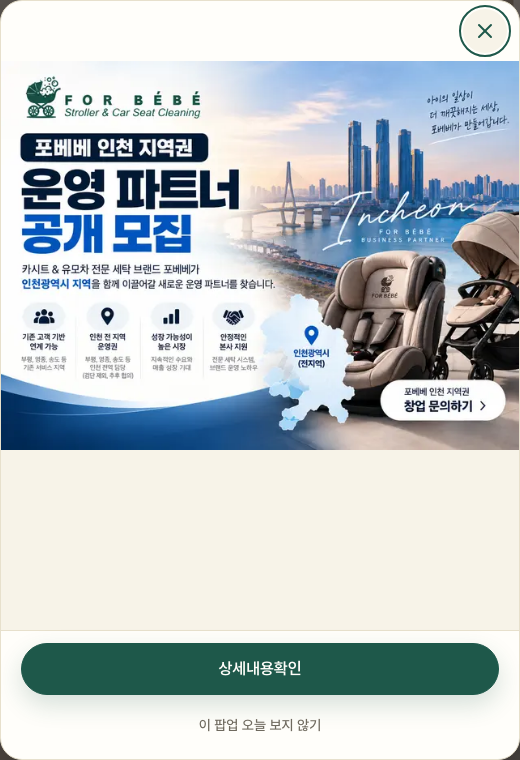 | 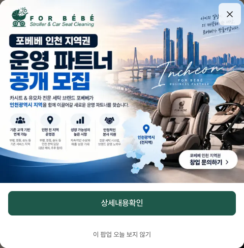 |

가로형 다중 팝업(팝업 영역 확대):

| 수정 전 | 수정 후 |
| --- | --- |
| 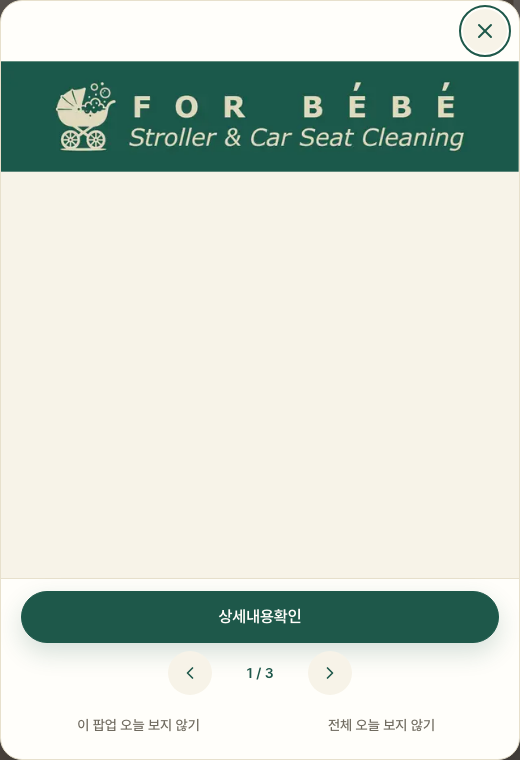 | 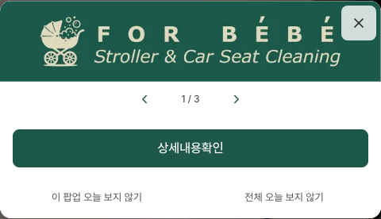 |

모바일 375px 단일 팝업:

| 수정 전 | 수정 후 |
| --- | --- |
| 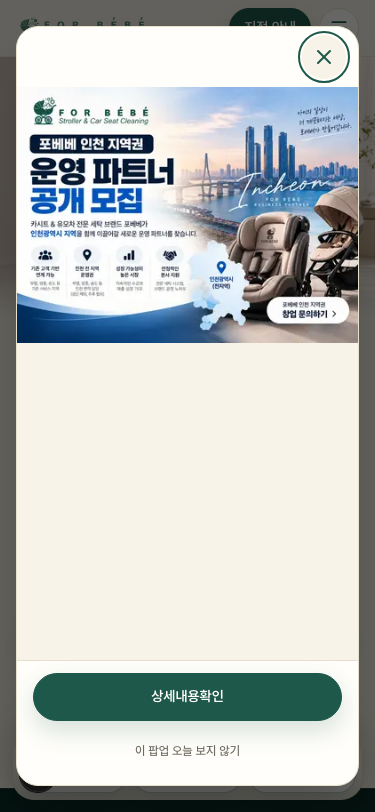 | 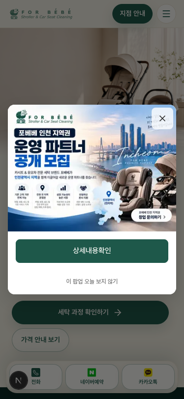 |

모바일 390px 다중 팝업:

| 수정 전 | 수정 후 |
| --- | --- |
| 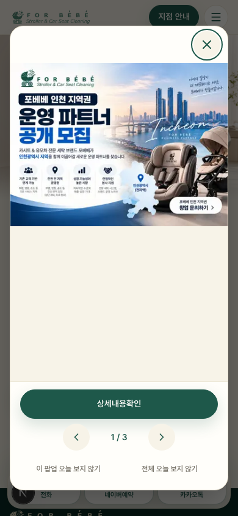 | 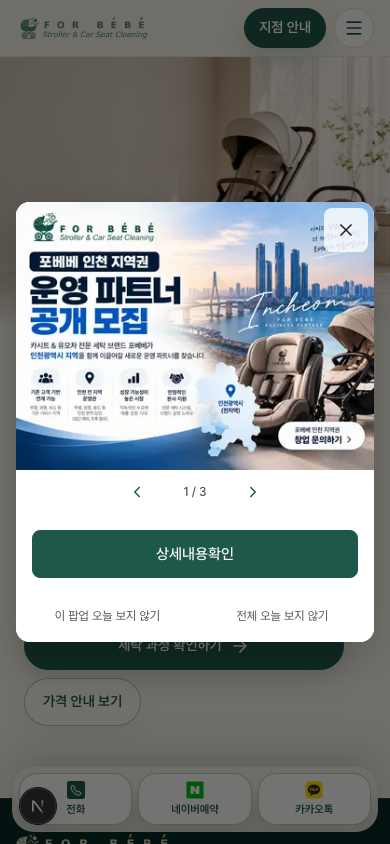 |

세로형 팝업:

| 수정 전 · 375×667 | 수정 후 · 375×667 | 수정 후 내부 스크롤 · 375×568 |
| --- | --- | --- |
| 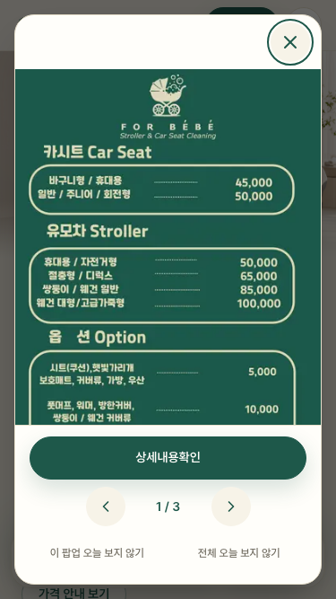 | 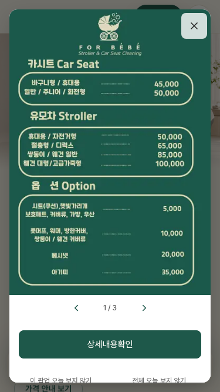 | 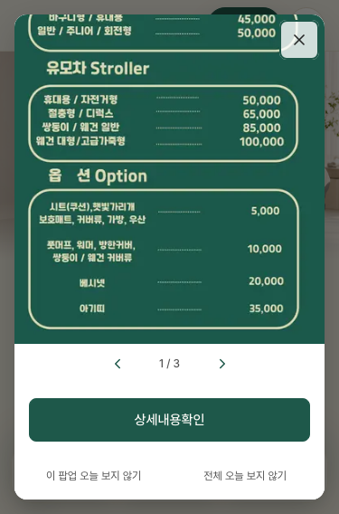 |

PC 전체 화면: [단일 이전](./before-desktop-single.png) · [단일 이후](./after-desktop-single.png) · [가로형 이전](./before-desktop-wide-multiple.png) · [가로형 이후](./after-desktop-wide-multiple.png).

## 변경 파일

- `src/components/ui/ImagePopup.tsx`: 자연 높이·전체 내용 스크롤·닫기 오버레이·작은 탐색 줄·팝업 전용 CTA 및 보조 조작 스타일, 화면 밖 포커스 보정.
- `docs/home-popup.md`: 최신 레이아웃·스크롤 안내.
- `docs/popup-redesign/`: 전후 스크린샷, 측정값, 이번 검증 보고서.

CMS 스키마·데이터, 팝업 준비 로직, 저장소·버전 정책, 공용 Button 컴포넌트는 수정하지 않았습니다.

## 검증

Chromium 브라우저 검증 12개와 기존 회귀 검사 13개를 통과했습니다. 브라우저 예외·hydration 오류는 없었습니다. 모바일 검증은 터치 에뮬레이션이며 실제 기기 검증은 포함하지 않습니다. 검증용 임시 경로는 제거했습니다.

| 항목 | 결과 |
| --- | --- |
| PC 가로형 1개·다중: 상단 0px, 이미지 아래 빈 공간 없음, 자연 높이·탐색 순서 | 통과 |
| 현재 CMS 이미지와 동일한 4:3 이미지: PC·375px·390px 자연 높이 및 모바일 좌우 16px | 통과 |
| CTA 48px·8px 모서리·그림자 없음, 텍스트 15~16px·500, 숨김 12~13px·터치 44px | 통과 |
| 세로 이미지: 원본 비율·전체 내용 보존, 내부 스크롤로 CTA·숨김 접근, 닫기 고정 | 통과 |
| 서로 다른 비율 전환 시 모달 높이 변화·위쪽 스크롤 초기화·내용과 링크 일치·순환 | 통과 |
| 내부 현재 탭·외부 새 탭·noopener noreferrer 유지 | 통과 |
| 개별 오늘 숨김·다음 항목·1개 남으면 전체 숨김 감춤·마지막 닫기 | 통과 |
| 전체 오늘 숨김 및 다음 로컬 날짜 재표시 | 통과 |
| X·Escape 전체 세션 숨김 및 새로고침 유지 | 통과 |
| 키보드 Tab·Shift+Tab·이미지 스크롤·배경 잠금·포커스와 원래 스크롤 복원 | 통과 |
| 375px·390px 실제 터치 좌우 스와이프 및 세로 스크롤 구분 | 통과 |
| SSR·숨김 팝업 깜박임 방지·저장소 접근 거부 환경 유지 | 통과 |

[자동 검증 결과 JSON](./verification.json)

최종 `npm run lint`, `npx tsc --noEmit`, `npm run build`를 통과했습니다. 프로덕션 빌드 경로에 임시 검증 화면이 포함되지 않는 것도 확인했습니다. 운영 배포는 하지 않았습니다.
